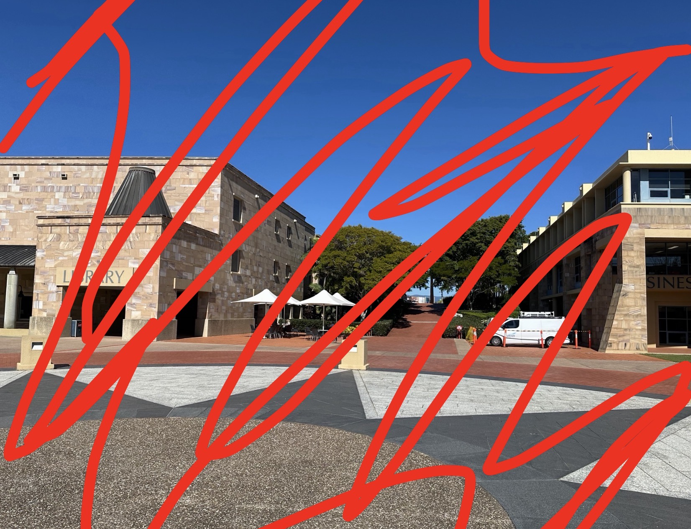
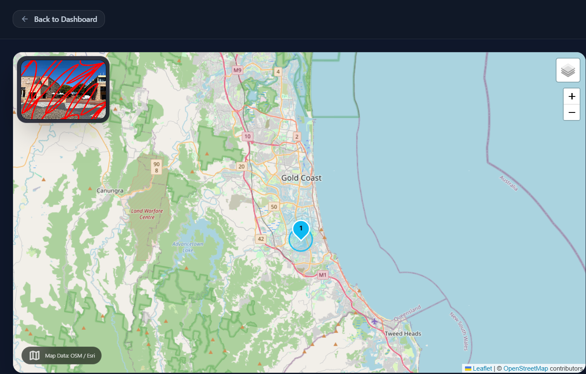

**Author**: Reven
**Platform**: OSINT Industries CTF
**Category**: OSINT/GEOINT
**Tools**: ExifTool, Yandex, CleanUp and Imagetolocation
**Flag**: OSINT{"bond_university_robina"}

**1. Challenge Description**

A photo has been recovered during an investigation.
Your objective is to determine **·** The name of the university where the photo was taken **·** The city in which it is located .

**2. Phase 1: Metadata Analysis**

The first step was to download the photo provided by the CTF. Once on my Kali Linux was open the terminal and run to parse the photo metadata with Exiftool, using the command "exiftool '/image_path.jpeg'". 
The image did not obtain metadata that could reveal information about where the photo was taken from. They had deleted coordinates and latitude and longitude information. 

**3. Phase 2: Traditional Reverse Search**

After failure using the exiftool, pivot to Yandex Images. With Yandex we had problems because the image had red stripes drawn.
With these lines Yandex presented false positives which complicated the search. I made the decision to run the image through a program to erase the lines (CleanUp), which was a bigger problem for Yandex because there were areas where I distorted them and the false positives increased even more. 

**4. Phase 3: The Pivot**

After the failures with exiftool and yandex I decided to use ImageToLocation which is an AI-based geolocation tool that analyzes visual context to deduce locations. 
ImageToLocation had no problems deducing the exact location of the image despite the annoying lines contained in the photo. And I mark the location exactly on the map.

**5. Phase 4: The Solution **

The first four flags I tried were rejected, due to format and a small mistake we made. The flags tested were: 
*OSINT{bond_university_gold_coast}*,
*OSINT{bond_gold_coast}*,
*OSINT{Bond_University_Gold_Coast}*,
*OSINT{bond_university_goldcoast}*,

**Why did they fail?**
**The name of the city** ImageToLocation detected that it was on the Gold Coast but the challenge was designed so that we were specific and asked for the exact suburb or district (Robina).
**The format** The CTF itself gave you the example: **OSINT{"harvard_university_cambridge"}**. We didn't put the double quotes because most CTFs don't use them, but in this one they were mandatory. By not including them, the system that validated the flags rejected the flag format as invalid.

## Images

  

 

  

